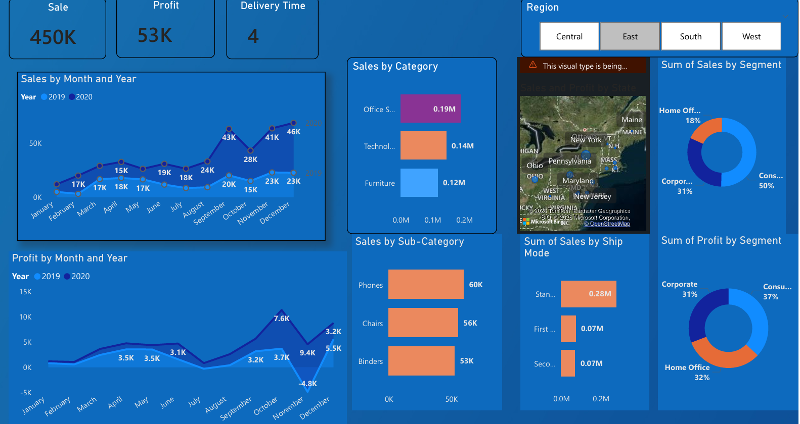
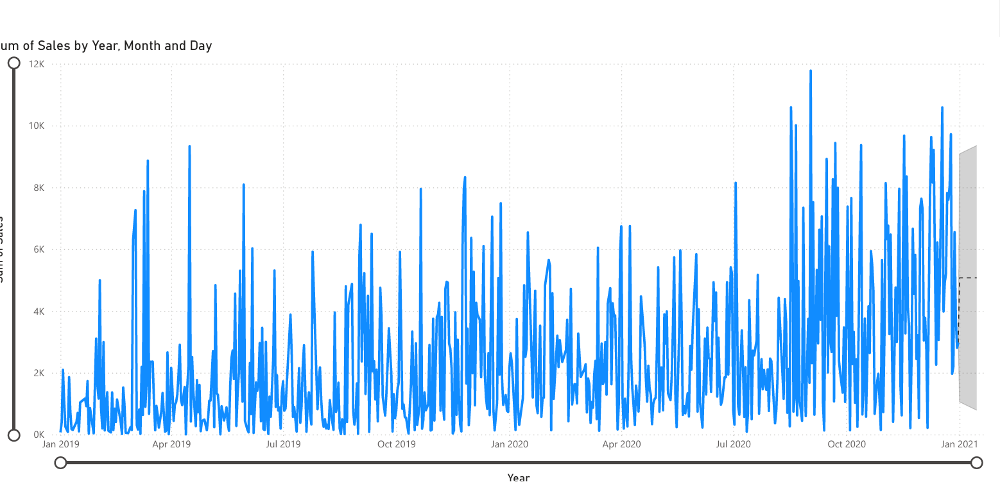

# Sales-Analytics-Forecasting-Dashboard-
An end-to-end sales performance and forecasting solution built using Power BI, featuring custom DAX modeling, interactive visual insights, time-series forecasting, and key performance indicators (KPIs) to drive business decisions.

## 🚀 Project Overview
This dashboard transforms raw sales data into actionable commercial insights. It analyzes historical trends across multiple years (2019–2020), tracks key profitability metrics, evaluates shipping and regional performance, and forecasts future sales trajectories using built-in analytics.

### Key Highlights from the Dashboard:
* **Total Sales:** 450K
* **Total Profit:** 53K
* **Average Delivery Time:** 4 Days
* **Time-Series Forecasting:** Projects future sales trends up to Jan 2021 based on historical seasonality.
---

## 🛠️ Key Features & Technical Implementation

### 1. Advanced DAX & Data Modeling
* **Calculated Tables & Columns:** Created custom tables and calculated columns using DAX to handle complex time-intelligence calculations (such as Year-over-Year comparisons, cumulative sums, and date hierarchies).
* **Measures:** Developed robust aggregation measures for dynamic filtering of Sales, Profit, and Category breakdowns.

### 2. Predictive Sales Forecasting
* Integrated Power BI's built-in **Forecasting feature** on daily sales data (spanning from Jan 2019 through Jan 2021).
* Includes confidence intervals (upper and lower bounds) to account for volatility and help stakeholders plan inventory and staffing effectively.

### 3. Key Performance Indicators (KPIs) & Insights
* **Top-Level Cards:** Instant visibility into **Sales (450K)**, **Profit (53K)**, and **Delivery Time (4 days)**.
* **Category & Sub-Category Breakdown:** Identifies top-performing product lines (e.g., Office Supplies, Technology, and Furniture).
* **Segment Analysis:** Evaluates consumer behavior across Consumer (50%), Corporate (31%), and Home Office (18%) segments.
* **Regional & Shipping Filters:** Interactive slicers for Central, East, South, and West regions alongside Shipping Modes (Standard, First Class, Second Class).

---

## 📈 Visual Dashboard Previews

### Overview & KPI Metrics
*Tracks monthly performance trends, profit distributions, category breakdowns, and segment share.*


### Sales Forecasting (2019–2021)
*Daily sales trend line showing historical fluctuations paired with a statistical forecast model projection into early 2021.*


---

## 📂 Repository Structure
```text
├── Dataset/                # Raw and cleaned dataset files (CSV/Excel)
├── PowerBI/                # .pbix Power BI dashboard file
├── DAX/                    # Documentation of custom DAX measures and calculated tables
└── Screenshots/            # Dashboard preview images
